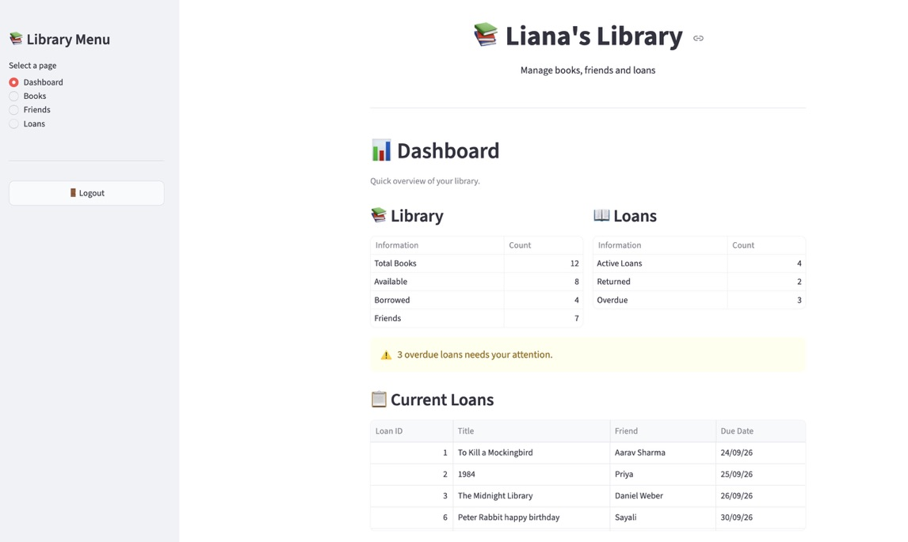
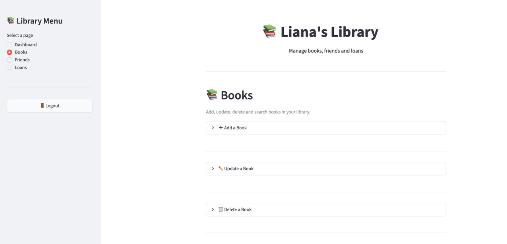
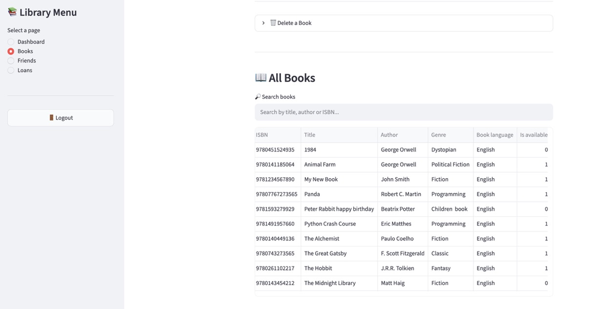
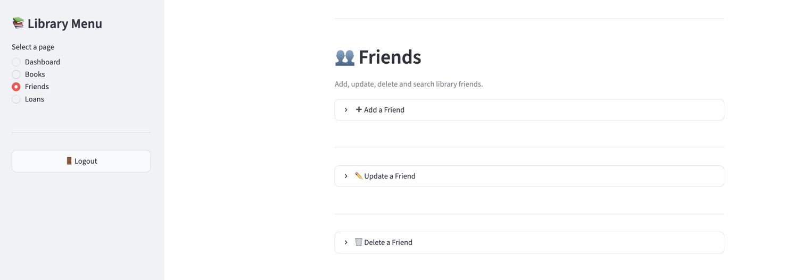
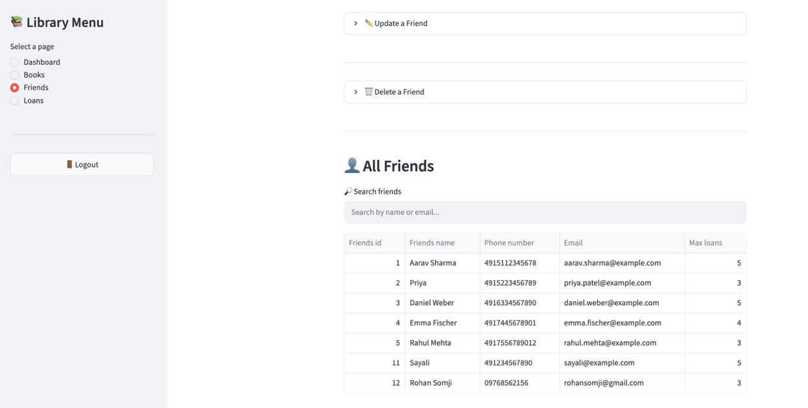
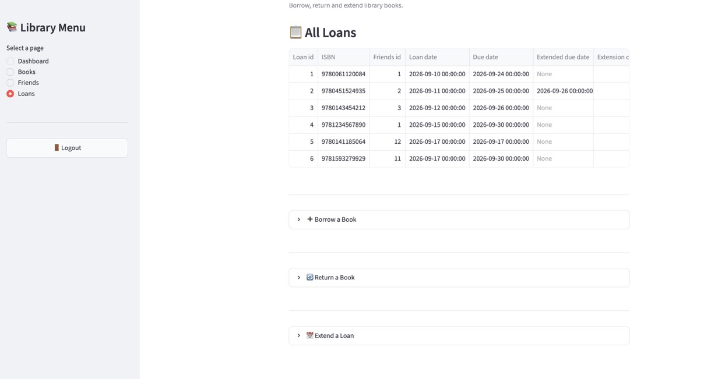
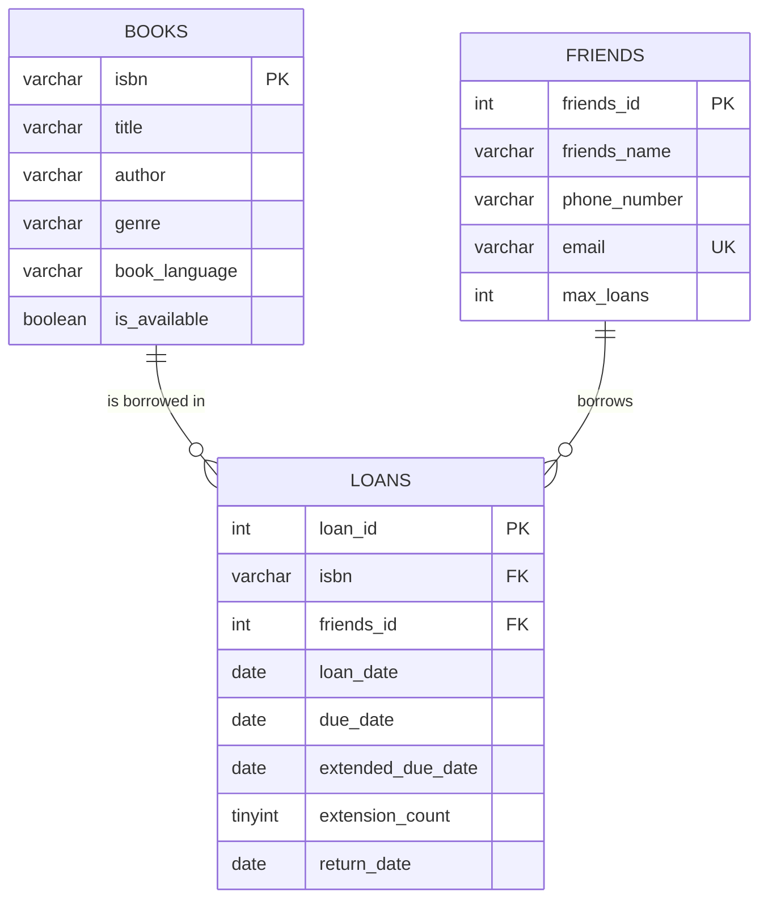

📚 **Liane's Library Management System**

Lending books to friends is easy. Remembering who has what, and when it is due back, is not. **Liane's Library** replaces the notebook and the memory game with a simple web app backed by a real relational database.

The app lets you manage a book collection, keep a list of borrowers, lend and return books, extend due dates, and see at a glance what is overdue. The Streamlit front end talks to MySQL through SQLAlchemy and PyMySQL.

## 📑 Table of Contents

- [Features](#-features)
- [Screenshots](#-screenshots)
- [Tech Stack](#-tech-stack)
- [Database Design](#-database-design)
- [Project Structure](#-project-structure)
- [Getting Started](#-getting-started)
- [How It Works](#-how-it-works)
- [Security](#-security)
- [Roadmap](#-roadmap)
- [Author](#-author)

---

## 🚀 Features

| | Feature | Details |
|---|---|---|
| 🔐 | **Secure login** | The library is only visible after logging in; logout from the sidebar |
| 📖 | **Book management** | Add, update, delete and search by title, author or ISBN |
| 👥 | **Friend management** | Add, update, delete and search borrowers by name or email |
| 📋 | **Loan tracking** | Lend an available book to a friend with a due date |
| 📬 | **Returns** | Mark a loan as returned; the book becomes available again |
| 🔄 | **Extensions** | Push a due date back; extended date and extension count are stored |
| ⚠️ | **Overdue alerts** | Dashboard flags active loans past their due date |
| 📊 | **Dashboard** | Totals for books, friends, active, returned and overdue loans, plus a live list of current loans |
| 🛡️ | **Data safety** | Duplicate ISBNs and emails are blocked, deletes need confirmation, and records with loan history cannot be deleted |

---

## 📸 Screenshots

### 📊 Dashboard
Live totals for books, friends and loans, an overdue warning and the list of current loans.



### 📚 Books
Add, update and delete books from expandable panels, then browse and search the full collection.

| Manage books | All books with search |
|---|---|
|  |  |

### 👥 Friends
Manage borrowers and search them by name or email.

| Manage friends | All friends with search |
|---|---|
|  |  |

### 📖 Loans
See every loan, then borrow, return or extend a book.



---

## 🛠️ Tech Stack

| Technology | Purpose |
|---|---|
| **Python** | Application logic |
| **MySQL** | Relational database |
| **Streamlit** | Web interface |
| **SQLAlchemy** | Python to MySQL connection and queries |
| **PyMySQL** | MySQL driver |
| **pandas** | Loading and displaying tables |
| **python-dotenv** | Environment variables in notebooks |
| **Jupyter** | Building and testing CRUD functions |

---

## 🗄️ Database Design

Three tables, linked with foreign keys.



**Design decisions**

- **ISBN as primary key** so every book is uniquely identified
- **Unique email** per friend
- **Personal loan limit** per friend (`max_loans`, default 5)
- **Renewal history** kept in `extended_due_date` and `extension_count`
- **Active loan** means `return_date` is empty
- **Sample data** included: 10 books, 5 friends and 3 loans

---

## 📁 Project Structure

```
lianes-library-app/
├── README.md
├── .gitignore
├── .streamlit/
│   └── secrets.toml          # not committed
├── images/                   # screenshots
├── sql/
│   ├── library_schema.sql    # schema and tables
│   └── datalibrary.sql       # sample data
├── notebooks/
│   ├── python_sql.ipynb      # connecting Python to MySQL
│   └── crud1_workflow.ipynb  # building and testing CRUD functions
└── src/
    ├── app.py                # Streamlit app and page routing
    ├── db.py                 # shared SQLAlchemy engine
    ├── login.py              # login page
    ├── create.py             # add books, friends, loans
    ├── read.py               # fetch books, friends, loans
    ├── update.py             # edit records, return and extend loans
    ├── delete.py             # remove books and friends
    └── requirements.txt
```

---

## ⚙️ Getting Started

### Prerequisites

- Python 3.10 or newer
- MySQL Server running on port `3306`

### Installation

**1. Clone the repository**

```bash
git clone https://github.com/YOUR_USERNAME/lianes-library-app.git
cd lianes-library-app
```

**2. Create a virtual environment and install dependencies**

```bash
python -m venv venv
source venv/bin/activate        # Windows: venv\Scripts\activate
pip install -r src/requirements.txt
```

**3. Set up the database**

```bash
mysql -u root -p < sql/library_schema.sql
mysql -u root -p < sql/datalibrary.sql
```

**4. Add your MySQL password**

Create `.streamlit/secrets.toml`:

```toml
[mysql]
password = "YOUR_MYSQL_PASSWORD"
```

**5. Run the app**

```bash
streamlit run src/app.py
```

Open **http://localhost:8501** in your browser.

---

## 🔧 How It Works

1. `app.py` creates one SQLAlchemy engine, stores it in the Streamlit session and shares it through `db.py`
2. If the user is not logged in, `login.py` shows the login page; otherwise the sidebar menu appears
3. Each page calls small functions from `create.py`, `read.py`, `update.py` and `delete.py`
4. Functions return a message (for example "Loan created" or "cannot be deleted") that the page shows as a success or warning

### Useful commands

| Command | What it does |
|---|---|
| `streamlit run src/app.py` | Start the app |
| `mysqldump -u root -p library > backup.sql` | Back up the database |
| `pip install -r src/requirements.txt` | Install dependencies |

---

## 🔒 Security

- The database password lives in Streamlit secrets, never in the code
- Values are sent to SQL as bound parameters
- `secrets.toml` and `.env` are excluded via `.gitignore`

---

## 🔮 Roadmap

- [ ] 💰 Automatic fines for overdue loans
- [ ] 🤝 Friend trust scores
- [ ] 🎁 Wishlist and ⭐ book reviews
- [ ] 🔍 Tracker IDs for loan lookup
- [ ] 🐳 Docker and Docker Compose deployment
- [ ] 🔑 Hashed passwords for login

---

## 👩‍💻 Author

**Sayali Madan Ware**
Data Analytics & AI, WBS Coding School

[](https://www.linkedin.com/in/sayali-ware)


